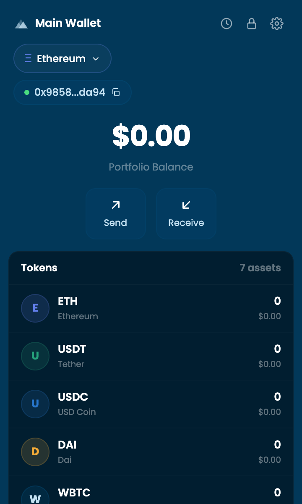
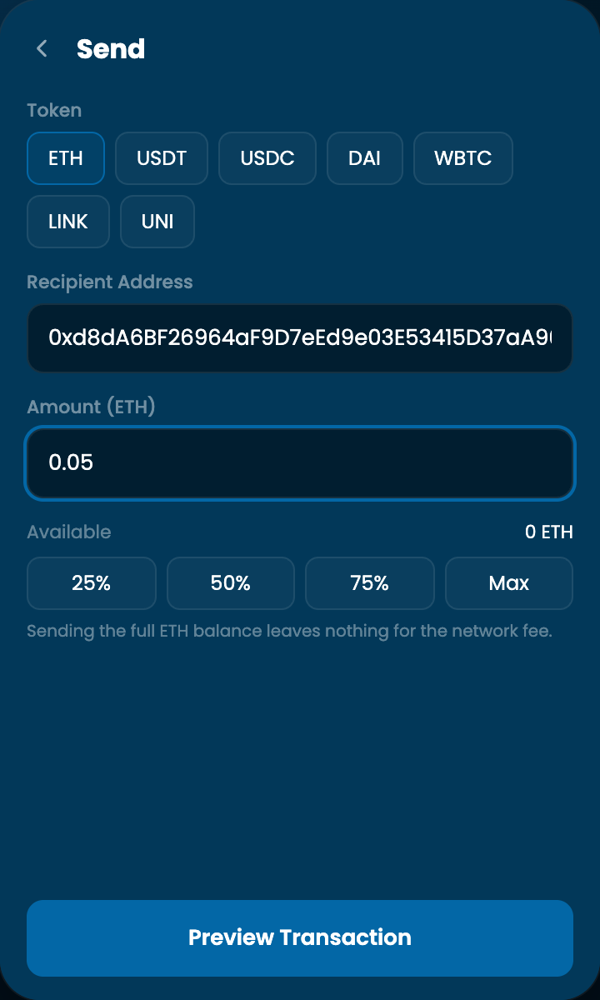
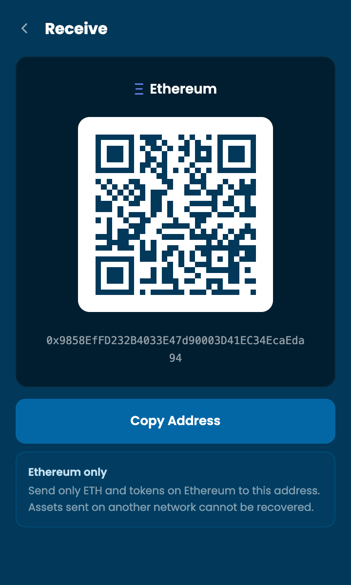
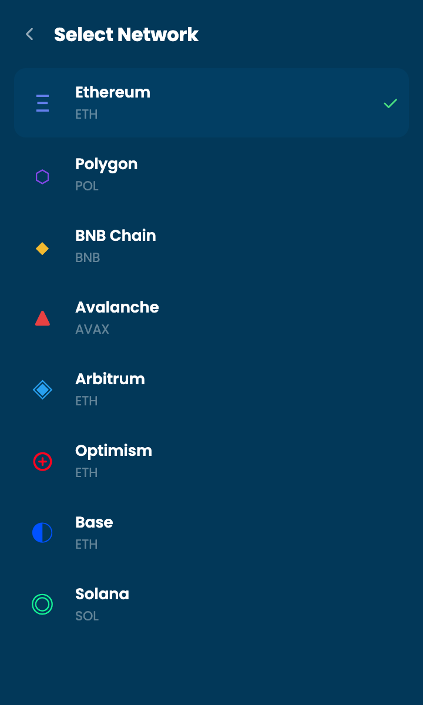
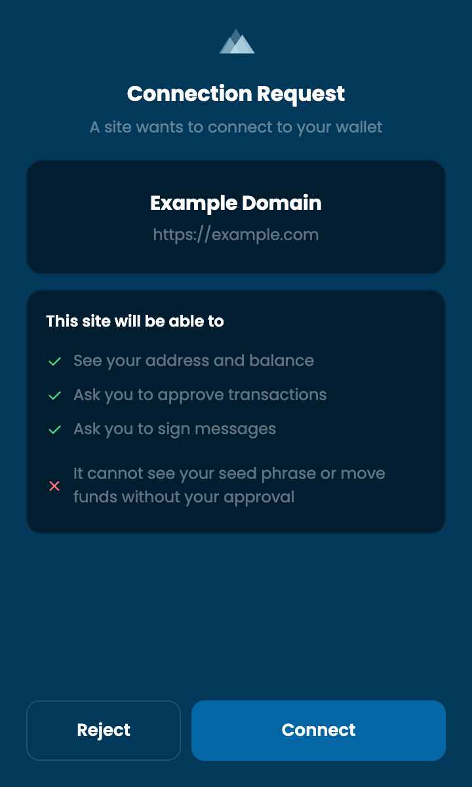
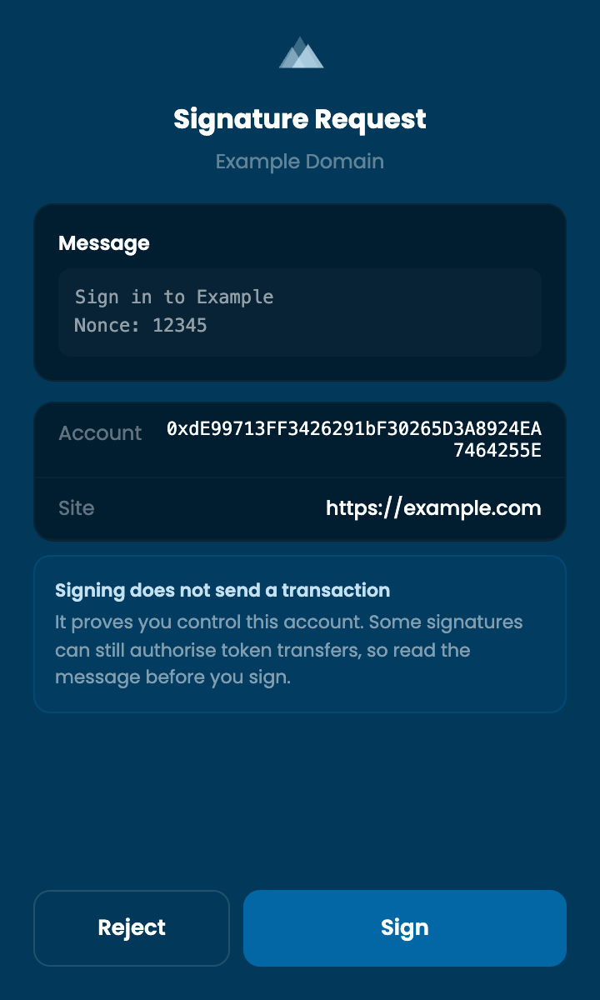
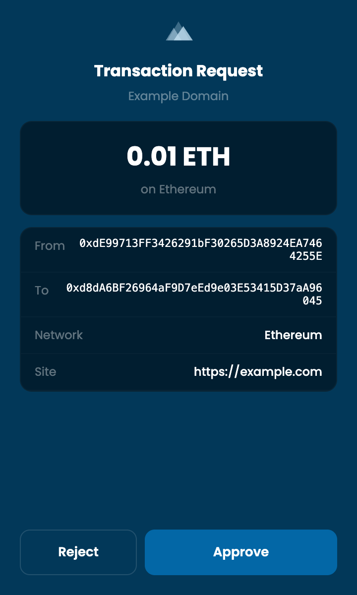
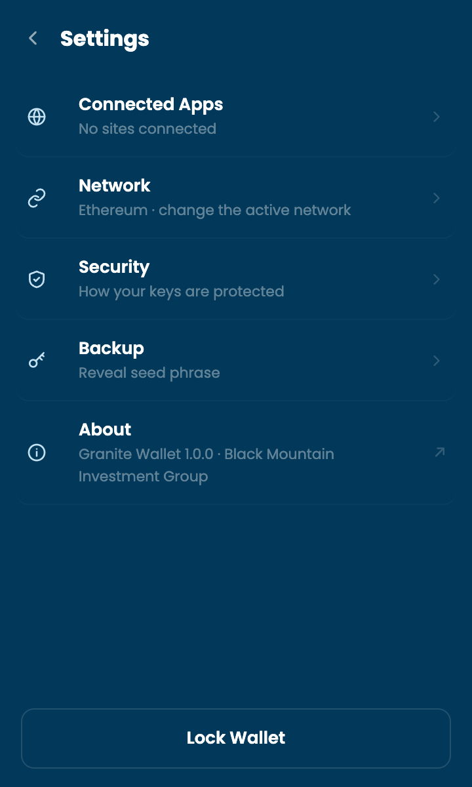

# Granite Wallet

Self-custody browser extension wallet for Ethereum, Polygon, BNB Chain, Avalanche, Arbitrum, Optimism, Base and Solana, by Black Mountain Investment Group. Your seed phrase is generated in the extension, encrypted with your password and never leaves your machine; there is no server, no account and no tracking.

**Version 1.0.** The code is open so anyone can read it and build it. It has not yet had an independent security audit; use amounts you are comfortable with until it has, and please report anything you find.

Website and privacy policy: https://kjniedz.github.io/granite-wallet/

<p align="center">
  
  
  
  
</p>
<p align="center">
  
  
  
  
</p>

## What it does

- Create a new 12-word wallet or import an existing 12 or 24 word BIP-39 phrase. One phrase gives you accounts on every supported chain (standard `m/44'/60'/0'/0/n` for EVM chains, Phantom-compatible `m/44'/501'/n'/0'` for Solana), so the same words work in MetaMask, Phantom and hardware wallets.
- See native and major token balances with USD values, send native coins and ERC-20 tokens with EIP-1559 fee tiers, receive with a real QR code, and keep a history of what you sent with links to the block explorer.
- Connect to dApps. The extension injects an EIP-1193 provider and announces itself through EIP-6963, handles `eth_requestAccounts`, `personal_sign`, `eth_signTypedData_v4`, `eth_sendTransaction` (with the dApp's calldata passed through untouched), chain switching, and forwards plain chain reads like `eth_call` to the RPC. Every connection, signature and transaction is shown in the popup and needs your approval.
- Lock after five minutes without use and whenever the browser closes. Reveal the seed phrase from Settings only after re-entering the password.

Not in this version: swaps, Bitcoin, hardware wallets, custom networks and tokens, Solana dApp connections (Solana works for send and receive only), and ENS names.

## Install

The Chrome Web Store listing is in preparation; `STORE.md` has the submission checklist and listing text. Until it is live, build from source.

Requirements: Node 20+ and npm 10+.

```bash
npm install
npm run build          # builds @granite/wallet-core, then the extension into packages/extension/dist
```

Then in Chrome (or Brave, Edge, Arc): open `chrome://extensions`, turn on Developer mode, click "Load unpacked" and choose `packages/extension/dist`. Chrome 111 or newer is required.

`npm run package` does a clean install, typecheck, tests and build, then writes `release/granite-wallet-chrome-v<version>.zip` for the Chrome Web Store.

## Development

```bash
npm run typecheck      # both packages
npm test               # wallet-core: derivation vectors, encryption, vault session, engine
npm run dev:extension  # vite build --watch; reload the extension after each change
```

End-to-end, against the built extension in a real browser (`e2e/`): creates a wallet, checks the bundled font loads and that the popup makes no external requests, locks and unlocks, reveals the phrase, renders the receive QR, connects a page, signs a `personal_sign` message and verifies the signature, signs EIP-712 data, rejects a transaction, switches chains, revokes the site, imports the BIP-39 reference phrase and checks the known addresses, and loads balances from the RPC. The same run writes the screenshots in `docs/screenshots/` (popup at 2x for this README, and 1280x800 framed images for the store under `docs/screenshots/store/`), so they never drift from the UI. Set `GW_NO_SHOTS=1` to skip them.

```bash
npm run build
cd e2e && npm install && npm run install-browser && npm test
```

```
packages/wallet-core   the wallet engine, no browser UI
  src/crypto           BIP-39 mnemonics, BIP-44 and SLIP-0010 derivation, AES-256-GCM vault encryption
  src/storage          encrypted vault (chrome.storage.local) and the unlocked session (chrome.storage.session)
  src/chains           EVM provider (ethers v5), Solana provider, CoinGecko prices, chain and token lists
  src/engine.ts        GraniteWallet: lifecycle, accounts, balances, sending, signing, dApp sessions
  test                 vitest
packages/extension     the Chrome extension (Manifest V3)
  src/background       service worker: message router, EIP-1193 request handling, approvals, auto-lock
  src/content          inpage.ts (the window.ethereum provider, main world) and content-script.ts (relay)
  src/popup            React popup UI
  public/manifest.json
  public/fonts         Poppins, bundled (SIL Open Font License)
e2e                    Playwright run of the built extension in Chromium; also produces the screenshots
docs                   the website (GitHub Pages from /docs): landing page, privacy policy, screenshots
scripts                packaging
PRIVACY.md             privacy policy source
STORE.md               Chrome Web Store listing text, permission justifications and reviewer notes
```

## Security model

- The seed phrase is encrypted with AES-256-GCM under a key derived from your password with PBKDF2-SHA256 at 600,000 iterations and a random salt. The ciphertext lives in `chrome.storage.local`; wallet metadata (names and public addresses) is stored unencrypted next to it.
- While unlocked, the decrypted phrase is kept in `chrome.storage.session`, which is memory only, readable by the extension's own trusted contexts only, and cleared when the browser exits. This is what lets the wallet stay unlocked across the service worker being put to sleep. The session expires after five minutes without activity.
- Private keys are derived from the phrase at signing time and discarded; they are never stored.
- Pages talk to the wallet only through the injected provider. The site's origin is taken from the content script's own window, wallet-control messages are accepted only from the extension's own pages, a site must be connected before it can ask for a signature, and it can only sign for the account it was connected with. `eth_sign` is disabled.
- `personal_sign` decodes hex messages to bytes before signing (EIP-191), so Sign-In with Ethereum and similar logins verify. EIP-712 signing strips the `EIP712Domain` type as ethers expects.
- Nothing leaves the machine except RPC calls to the public endpoints in `packages/wallet-core/src/chains/config.ts` and price lookups to CoinGecko. The font is bundled; the popup makes no other requests, and the e2e run asserts that. Point the RPC URLs at your own provider if you prefer. See `PRIVACY.md`.

Found a problem? Open an issue, or email security concerns to hello@blackmountainig.com before posting details publicly.

## License

MIT, see `LICENSE`. Poppins is by the Indian Type Foundry under the SIL Open Font License (`packages/extension/public/fonts/OFL.txt`).
